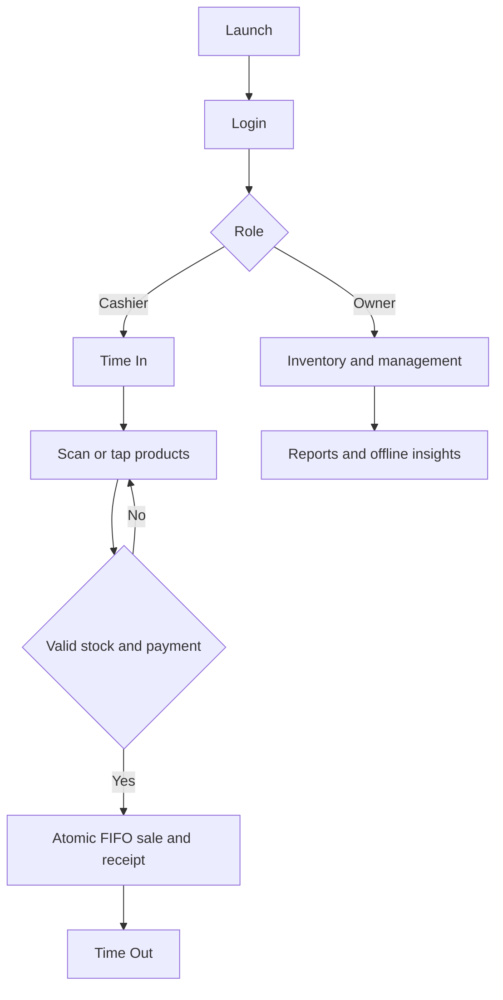
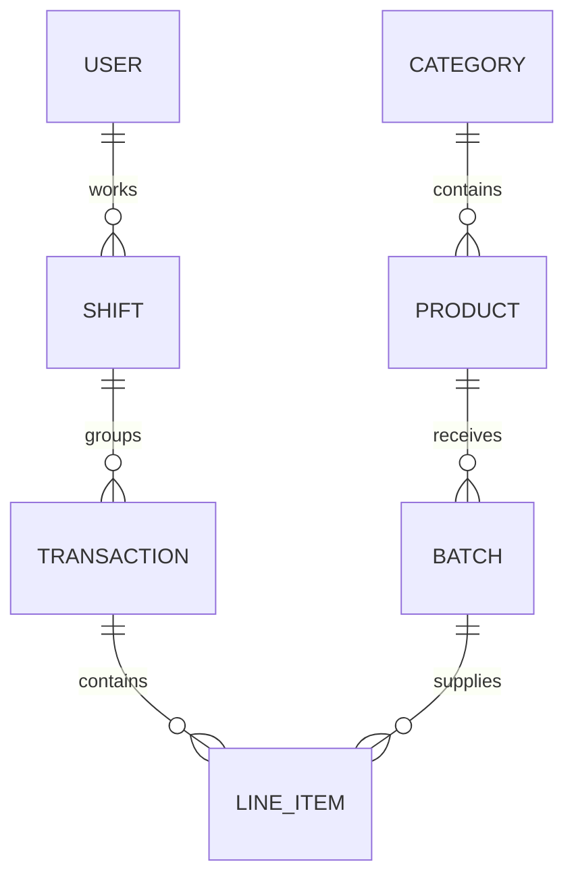

# System design

Compose screens call ViewModels, then repositories. Room transactions enforce stock and shift rules. Room stores users, categories, products, receipts, lines, audit entries, batches, shifts and suppliers. Each receipt line snapshots its batch date/cost. Shift totals are derived from receipts. LocalAiService uses JNI/llama.cpp with pre-calculated facts. WorkManager handles daily summaries.

Historical user/product/batch relationships use snapshots rather than deleting receipts. Supplier names are copied into batches, so deleting a supplier does not erase history.
